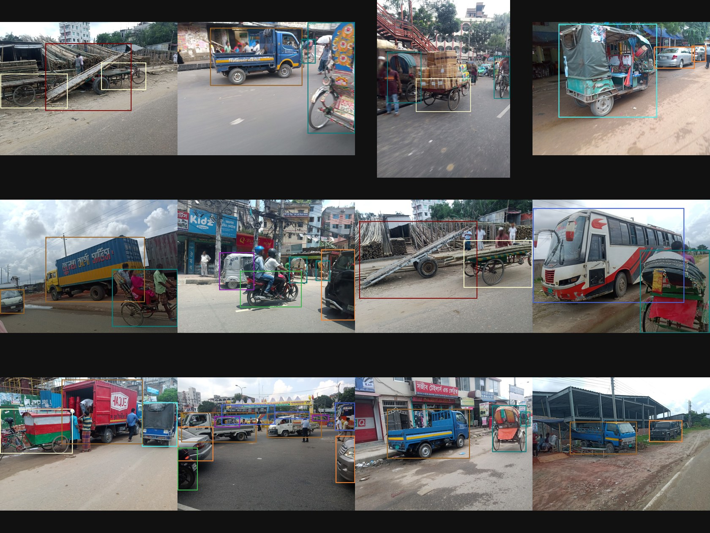

# Vehicle detection (YOLOv9)

Real-time vehicle detection for South Asian traffic, trained on 15 local
vehicle classes including rickshaw, CNG, easybike, leguna and horsecart.
Runs ONNX inference on an RTSP IP camera, a webcam or a video file, and
serves the annotated frames to a browser.



## Classes

`bicycle`, `bike`, `boat`, `bus`, `car`, `cng`, `easybike`, `horsecart`,
`launch`, `leguna`, `rickshaw`, `tractor`, `truck`, `van`, `wheelbarrow`

## Before you start: the model file

Model weights are **not stored in git** — they are large binaries, excluded
by [.gitignore](.gitignore). A fresh clone will not run until you copy the
exported model in:

```
models/EEE_project_yolov9s.onnx     28 MB, the default
models/EEE_project_yolov9c.onnx     97 MB, more accurate and much slower
```

The same applies to `demo/dhaka/EEE_project_demo.mp4`, which only
`run-demo.bat` needs.

## Windows

```bat
setup.bat
```

Creates a virtual environment, installs the dependencies, and reports
anything missing. Run it once. Then:

```bat
run.bat                        pick a source interactively
run.bat --source 0             laptop webcam
run.bat --source rtsp://...    IP camera
run-demo.bat                   replay the recorded clip as a fake camera
```

Open <http://localhost:8000>. The startup banner also prints a LAN address,
so a phone or laptop on the same wifi can watch.

`setup.bat` prefers Python 3.10–3.12 when available, because `onnxruntime`
(about 2× faster) has no wheels above 3.12. On a newer Python everything
still works, just on the slower OpenCV DNN backend.

## macOS / Linux

```bash
python3 -m venv .venv && .venv/bin/pip install -r requirements.txt
```

```bash
.venv/bin/python detect.py --source 0
```

To replay the recorded clip, the detector must be listening **before** the
publisher dials in. Terminal 1:

```bash
OPENCV_FFMPEG_CAPTURE_OPTIONS="rtsp_flags;listen|rtsp_transport;tcp" .venv/bin/python detect.py --source rtsp://127.0.0.1:8554/live
```

Terminal 2:

```bash
.venv/bin/python demo/rtsp_server.py
```

## Useful flags

| Flag | Why |
|---|---|
| `--setup` | Build an RTSP URL step by step; asks the brand and hides the password |
| `--token SECRET` | Require `?t=SECRET` to view. Use whenever the page leaves your machine |
| `--quality 45` | Lower JPEG quality. MJPEG is ~24 Mbit/s at 720p/q55/15fps, so drop this for remote viewers |
| `--window` | Native desktop window instead of the browser |
| `--connect` | Let viewers change the camera from the browser. Needs `--token` off localhost |
| `--model` | Point at the `yolov9c` export for higher accuracy |

## Performance

Inference is CPU-bound. On a 2015 MacBook Pro the `yolov9s` model runs at
about **0.5 fps** with the OpenCV DNN backend. `onnxruntime` roughly doubles
that; a CUDA machine with `onnxruntime-gpu` reaches real time. Budget for
this before demoing on an old laptop.

## Security notes

- Never expose the camera itself to the internet. Run the detector on the
  camera's LAN and publish only the viewer, behind `--token`.
- `parse_source()` in [src/server.py](src/server.py) deliberately accepts
  only RTSP/HTTP URLs, webcam indices, and video files inside the project
  directory, so the browser picker cannot be used to probe internal hosts
  or read arbitrary files.
- RTSP passwords are read with `getpass` and redacted by `redact()` before
  reaching a browser or a log.

## Layout

```
detect.py              entry point, argument parsing, RTSP setup wizard
src/camera.py          capture thread, keeps only the newest frame, reconnects
src/detector.py        ONNX inference, NMS, box drawing
src/server.py          MJPEG HTTP server and the browser UI
src/viewer.py          native window mode
demo/rtsp_server.py    publishes a video file as a fake RTSP camera
training/              dataset audit, VOC conversion, Kaggle training helpers
models/runs/           training curves, confusion matrix, validation batches
```

Training runs on Kaggle; see `training/push_to_kaggle.sh` and the notebooks
in `notebooks/`.
